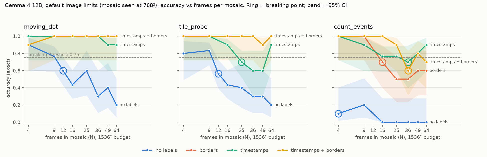
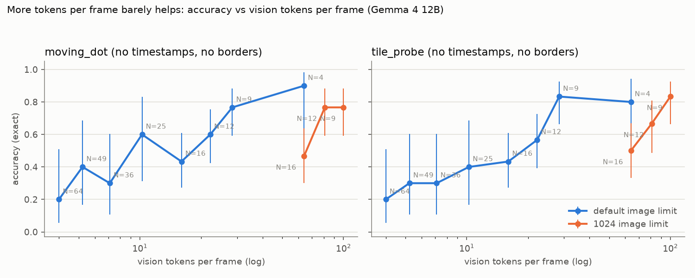
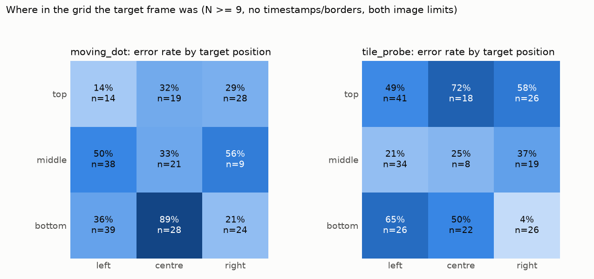
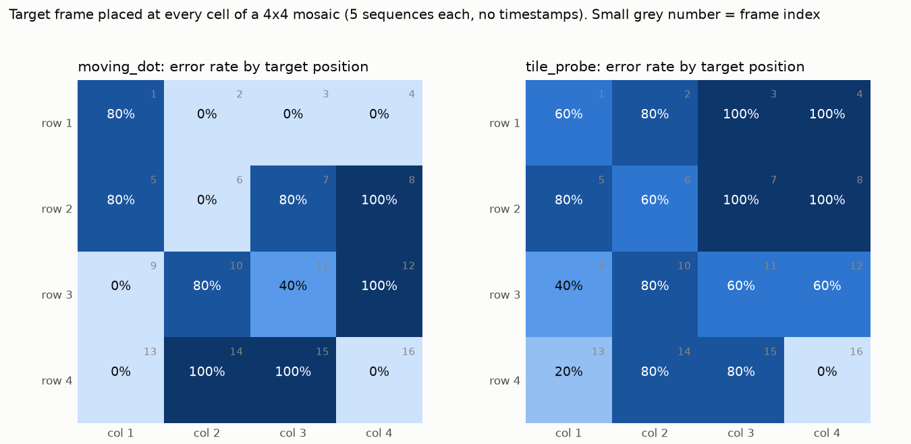
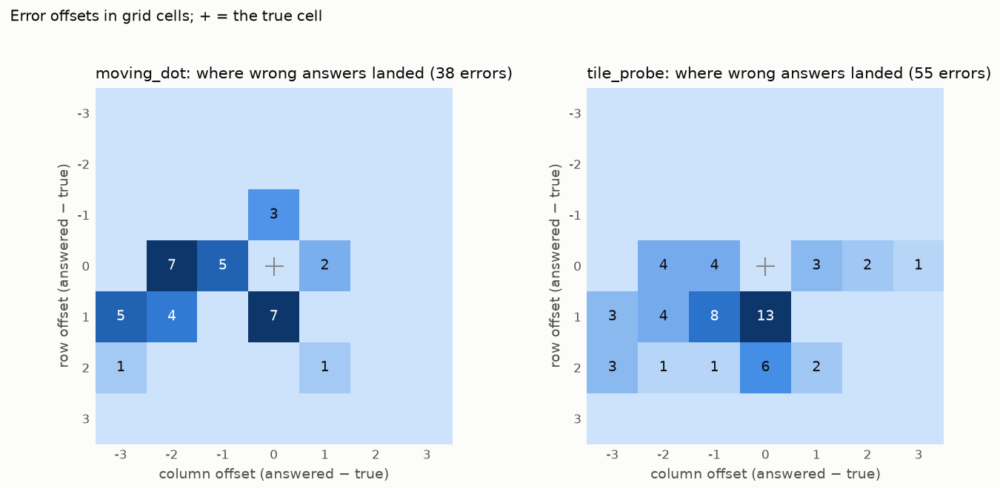
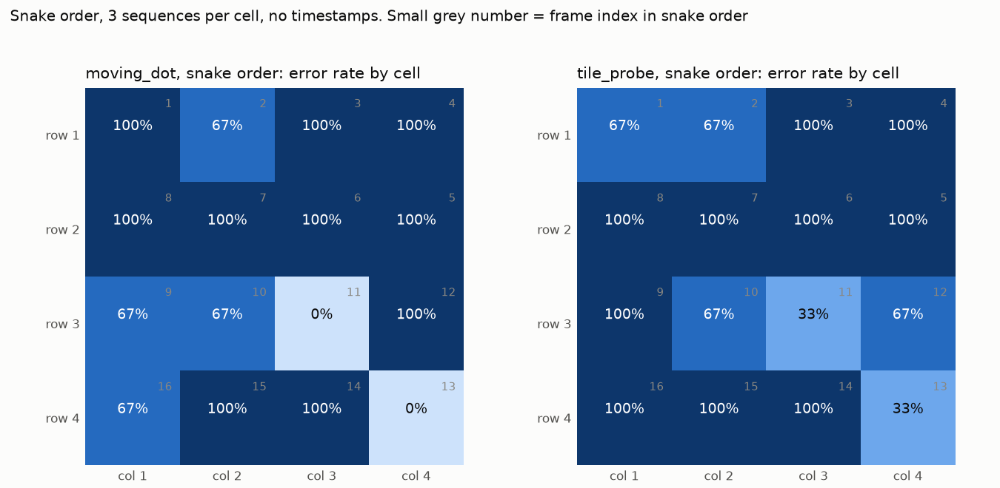

# How much time fits in an image? Capacity limits of frame mosaics for VLMs

**Draft, 2026-10-22. Main results: Gemma 4 12B, with preliminary Qwen 3.5 9B results.** Numbers come from `results/*.jsonl`; the figures and
tables are regenerated by `python -m analysis.make_all` (`analysis/effects.md` holds every number behind each figure).

## Question
Packing video frames into one grid image ("mosaic") is a cheap stand-in for video input. How many frames can a
vision-language model reliably read from one mosaic, and what makes it break? This is the time analogue of
DeepSeek-OCR's accuracy-vs-compression curve for text.

## Method
- **Frames with exact answers** (`gen/`): synthetic 512×512 frames, seeded so every sequence can be regenerated.
  This draft uses three tasks:
  - **moving_dot:** a dot turns from blue to red at one frame. "Which frame?"
  - **tile_probe:** one of N near-identical frames has a red star. "Which frame?"
  - **count_events:** K frames flash a yellow star. "How many?"
- **Mosaics** (`mosaic/`): N ∈ {4, 9, 12, 16, 25, 36, 49, 64} frames in a near-square grid, read row by row.
  - Fixed 1536² pixel budget, so tiles shrink as N grows.
  - Tile sizes are multiples of the model's 48 px patch.
  - Optional frame numbers burned into each tile's top-left corner ("timestamps"); answer content is kept out of
    that corner.
  - Optional 2–4 px tile borders.
- **Model and server:**
  - Gemma 4 12B it QAT, Q4_0 GGUF (`lmstudio-community/gemma-4-12B-it-QAT-GGUF`) with its BF16 vision projector.
  - Served by the official llama.cpp **b9555** Vulkan build on an RX 9070 XT.
  - Temperature 0, seed 0, thinking off. Every call is logged with the exact server command.
- **What the model actually sees:**
  - llama.cpp resizes every image before the vision encoder (`docs/preprocessing.md`).
  - Under Gemma's **default** limits, any image of 768² or larger is squashed to 768², which costs 256 vision tokens.
  - With `--image-max-tokens 1024`, a 1536² mosaic is kept at full size (1024 tokens).
  - Our port of the resize rule predicts the server's token count exactly in every call.
- **Questions and scoring** (`eval/`):
  - The prompt describes the grid layout and reading order and asks for "the frame number only" or "the number only".
  - Scoring is exact match, with off-by-one as a secondary metric.
  - No answer failed to parse in the main Gemma sweep. Controlled-position runs include cut-off answers,
    which count as wrong and unparsed.
- **Sample sizes:** 10 sequences per cell, 30 where the curve drops sharply. 95% Wilson intervals are shown.
  The main Gemma analysis subset contains 1,100 calls; the 160-call pilot is excluded from that subset.
  Controlled-position experiments and preliminary Qwen runs are additional records.
- **Breaking point:** the first tested N with accuracy below **0.75**. A 1-in-4 error rate is where a frame index
  stops being usable for downstream reasoning. It is also far above chance for these tasks (1/N for frame
  localisation).

## Results

**1. Without frame labels, Gemma loses track of the grid at 12 frames.**
- With no timestamps and no borders, the breaking point is **N=12 (224 px tiles)** for both moving_dot and tile_probe.
- At 30 sequences per point:
  - tile_probe falls from 0.83 at N=9 to 0.57 at N=12 to 0.43 at N=16.
  - moving_dot falls from 0.77 to 0.60 to 0.43.
- By N=64 both are at 0.2.

**2. Burned-in timestamps remove most of the limit.**
- Effect sizes are paired on identical sequences, pooled across N, with bootstrap 95% CIs:

  | task | with timestamps − without |
  |---|---|
  | moving_dot | **+0.47** (+0.36 to +0.59) |
  | tile_probe | **+0.37** (+0.26 to +0.48) |
  | count_events | **+0.80** (+0.70 to +0.89) |

- With timestamps:
  - moving_dot never breaks: it stays ≥ 0.9 up to N=64, at 96 px per frame.
  - tile_probe breaks at N=25.
  - count_events breaks at N=36.

**3. Borders fix counting without labels, and finish the job for localisation with labels.**
- Without timestamps or borders, count_events scores **0.04**, even at N=4.
  - The model answers "0" or "4" for two stars, because the dark empty frames merge into one background.
- Borders alone raise it to 0.70 (+0.66, CI +0.54 to +0.77).
- With timestamps already on, borders lift tile_probe from 0.81 to **0.99** (+0.17, CI +0.09 to +0.26).
  It then holds 0.9–1.0 at every N up to 64.
- Borders add nothing to moving_dot or count_events when timestamps are already on.

**4. Grid size matters far more than resolution.** (4× the tokens gives a real but small +0.06.)
- Raising the image limit from the default to `--image-max-tokens 1024` gives 4× the vision tokens.
  - Without labels at N=9–16, that moves accuracy only from 0.61 to 0.67.
  - Paired over 180 sequences, +0.06 (CI +0.02 to +0.11). Exact McNemar test: 16 sequences improved, 5 got worse,
    p = 0.027.
  - At N=9 the extra resolution changes nothing: the same 25 of 30 tile_probe sequences are right either way.
- **At the same 64 vision tokens per frame,** N=4 at default limits scores 0.90 (moving_dot), but N=16 at 1024
  tokens scores 0.47.
- So what limits Gemma is keeping track of position in a bigger grid, not pixels per frame. This is the opposite
  of the text case, where DeepSeek-OCR shows accuracy tracking tokens per unit of content.

**5. Position matters.** The pooled heatmap above mixes grid sizes and has only 8–41 calls per bin, so it is
only a hint. The controlled run below replaces it.

## Model 2: Qwen 3.5 9B (coarse sweep, preliminary)
Model: `Jackrong/Qwopus3.5-9B-Coder-MTP` Q4_K_M + F32 mmproj, the only vision-capable Qwen 3.5 in
`~/.lmstudio/models`. It is a coder fine-tune, not stock Qwen 3.5. Same b9555 Vulkan server, default image limits,
thinking off. Same grid and sequences as `coarse_gemma4_default` (420 calls, `results/coarse_qwen35_default.jsonl`,
0 unparsed, 0 cut off, 1.8 s/call).

**Not token-matched.** Qwen's default cap is 4096 image tokens, so every 1536² mosaic is encoded at full size
(2304 tokens, probe-checked). Gemma squashes the same image to 768² (256 tokens). Qwen sees about 9× the tokens.

Accuracy by N (4, 9, 16, 25, 36, 49, 64), 10 sequences per cell (95% CI about ±0.25 per cell):

| task | frame numbers | Qwen | Gemma | mean Q / G |
|---|---|---|---|---|
| moving_dot | off | 0.2 0.6 0.1 0.3 0.3 0.2 0.2 | 0.9 0.7 0.4 0.6 0.3 0.4 0.2 | 0.27 / 0.50 |
| moving_dot | on | 0.2 1.0 0.8 0.9 0.8 0.6 0.4 | 1.0 1.0 1.0 1.0 1.0 0.9 0.9 | 0.67 / 0.97 |
| tile_probe | off | 0.7 0.5 0.4 0.3 0.2 0.2 0.0 | 0.8 0.9 0.2 0.4 0.3 0.3 0.2 | 0.33 / 0.44 |
| tile_probe | on | 1.0 0.8 0.8 0.8 0.8 0.8 1.0 | 1.0 1.0 0.9 0.7 0.6 0.6 0.9 | 0.86 / 0.81 |
| count_events | off | 0.0 0.5 0.2 0.3 0.6 0.7 0.6 | 0.1 0.2 0.0 0.0 0.0 0.0 0.0 | 0.41 / 0.04 |
| count_events | on | 1.0 0.8 0.6 0.2 0.6 0.6 0.5 | 1.0 0.9 0.9 0.7 0.7 0.8 0.9 | 0.61 / 0.84 |

- **Frame numbers help Qwen too**, but its "which frame?" curve falls at N=49–64 (moving_dot 0.6, 0.4) where
  Gemma holds at 0.9. More image tokens did not buy position tracking.
- **moving_dot N=4: Qwen answers "4" on all 20 calls**, with or without frame numbers (truth is 2–4; Gemma 19/20).
  Cause not checked yet. Elsewhere Qwen answers N about as often as Gemma does on moving_dot and tile_probe.
- **count_events without frame numbers:** both models often answer N, i.e. count frames, not events (Gemma 58/70,
  Qwen 33/70). Qwen does it less as N grows (4, 0 and 1 of 10 at N=36/49/64) and gives real counts there
  (0.6–0.7), while Gemma stays at 0. Checked against the raw answers: none of Qwen's correct answers equal N.
- tile_probe with frame numbers is the one cell where Qwen matches or beats Gemma (0.86 vs 0.81, within noise).
- Confounds not separated: model, fine-tune, quant (Q4_K_M vs QAT Q4_0) and the 9× image-token gap. A
  `--image-max-tokens 256` run would separate the last one.

## Where the model loses its place
**Design** (`eval/position_run.py`, 192 calls):
- tile_probe and moving_dot at N=16 (a 4×4 grid), no timestamps, no borders, default image limits.
- The target frame was placed **at every one of the 16 positions on purpose**, 5 fresh sequences per position.
- Control: 1 sequence per position with timestamps on.
- Analysis is in `analysis/position.py`; all tables are in `analysis/position.md`.

| task | error rate, no timestamps | error rate, timestamps on (control) |
|---|---|---|
| moving_dot | 0.47 (38/80) | 0.19 (3/16) |
| tile_probe | 0.69 (55/80) | 0.12 (2/16) |

**Errors depend on the position, not the sequence.**
- Most positions are either always right or almost always wrong across their 5 different sequences.
  - moving_dot is never wrong at positions 2, 3, 4, 6, 9, 13 and 16, and is wrong 80–100% of the time at
    7, 8, 10, 12, 14 and 15.
- The bottom-right cell (frame 16) is right every time in both tasks.

**Wrong answers snap to the first cell of a row.**

| task | wrong answers (parsed) | answered a row's first cell (1, 5, 9, 13) | chance if spread evenly |
|---|---|---|---|
| moving_dot | 35 | 25 (71%) | 27% |
| tile_probe | 55 | 31 (56%) | 27% |

moving_dot has 3 further wrong answers at position 1 where Gemma started explaining instead of answering and hit the
16-token answer cap. Cut-off answers count as wrong and unparsed (`eval/score.py::apply_truncation_rule`).

- The most common answers overall are 13 and 9, the first cells of rows 4 and 3. Examples:
  - moving_dot targets at 14 and 15 come back as 13.
  - targets at 7 and 10 come back as 9.
  - a tile_probe target at 4 comes back as 12.
- Gemma seems to find roughly the right region, then report the frame number of a nearby row start instead of
  counting along the row.
- **Answer-prior caveat:** moving_dot is never wrong at 9 and 13 (its favourite wrong answers), but 80% wrong at
  row starts 1 and 5. So some "always right" cells may be free hits from a 9/13 preference, not a row-start habit.
  Same in snake order: moving_dot frames 13 and 11 are 0% error and are the two most common snake answers.
  A no-target control (same question, no red dot anywhere) would separate the two. Not yet run.

**Error vectors are neither clean row slips nor clean column slips.**

| task | row slip (±4 frames) | column slip (±1 in the row) | ±1 across a row break | diagonal | 2+ cells away |
|---|---|---|---|---|---|
| moving_dot | 26% | 18% | 13% | 0% | 34% (+8% cut off, no answer) |
| tile_probe | 24% | 13% | 5% | 15% | 44% |

- tile_probe errors lean **down**: answers are one or two rows too late, and the same column or to the left.
- moving_dot errors lean **left within the row** (back toward its first cell) or one row down.
- Both directions fit the snap-to-row-start pattern.

**The moving_dot "turns red and stays red" design is not the main driver.**
- Of the 77 parsed answers, 20 (26%) named a red frame that was not the first red one, and 15 (19%) named a blue
  frame.
- **None** named the last frame (16). An earlier draft counted 3 such answers at position 1, but they were cut-off
  explanations, not answers.
- Error rates are similar for changes in the first and second half of the grid (0.38 vs 0.53).
- Late answers are mostly snaps to 9 or 13, not "the last red frame". But a snap that lands after the change is
  also a red frame, so this run cannot fully separate the two explanations.

**Snake order: the snap follows the reading order, not the left edge** (96 calls, the same 3 sequences per position
as the row-major run).

In snake order, frames 5 and 13 (row starts in reading order) are drawn on the **right** edge, and frames 8 and 16
on the left. A left-edge habit and reading-order counting therefore predict different answers.

| task | order | accuracy | wrong answers on a reading-order row start drawn on the right edge | on a left-edge cell that is not a row start | the true cell's row-major number |
|---|---|---|---|---|---|
| moving_dot | row-major | 0.54 | n/a | 0% | 0% |
| moving_dot | snake | 0.21 | 26% | 0% | 5% |
| tile_probe | row-major | 0.27 | n/a | 0% | 0% |
| tile_probe | snake | 0.17 | 40% | 2% | 20% |

- Wrong snake answers almost never land on a left-edge cell that isn't a row start (0–2%). They land on
  reading-order row starts drawn on the right edge, mostly 13.
- **Wrong answers are the same number in both layouts:** 60% of moving_dot pairs and 65% of tile_probe pairs where
  both layouts were wrong.
  - In no pair did the snake answer follow the cell the row-major answer pointed at on screen.
  - The error lives in frame-number space ("about frame 13"), not in screen position.
- About 1 in 5 tile_probe errors read the true cell with the row-major formula, i.e. the model ignored the stated
  snake order.
- **Snake order costs accuracy:** moving_dot drops from 0.54 to 0.21 and tile_probe from 0.27 to 0.17.
  - For moving_dot, 22 of 48 snake answers (all with the target in rows 1–2) were Gemma explaining its mapping
    until it hit the 16-token answer cap.
  - Among parsed answers, moving_dot snake accuracy is 10/26.

### Four fixes compared on the same sequences (N=16, every position, 3 sequences each)
The same 48 sequences per task under each condition (`analysis/position.md` has the full table):

| task | no labels | reasoning allowed | frame numbers | frame numbers + reasoning | column labels only | row labels only |
|---|---|---|---|---|---|---|
| moving_dot | 0.54 | **0.98** | **0.94** | 0.90 | 0.42 | 0.46 |
| tile_probe | 0.27 | 0.71 | **0.83** | 0.79 | – | – |
| mean output tokens | 3 | 270–350 | 2–3 | 270–350 | 3 | 3 |
| median latency | 0.5 s | 4–5.5 s | 0.5 s | 3.7–4.6 s | 0.6 s | 0.6 s |

Paired significance tests are exact McNemar.

- **Frame numbers and reasoning each fix most of the problem.**
  - moving_dot: 19 and 21 sequences fixed, none broken, p < 1e-5.
  - tile_probe: 27 and 22 fixed, 0 and 1 broken, p < 1e-5.
  - Frame numbers do it with about 100× fewer output tokens and about 9× lower latency.
  - Between the two: moving_dot is about level (0.94 vs 0.98). tile_probe leans toward frame numbers (0.83 vs 0.71),
    but that difference is not significant (p = 0.15).
- **They don't stack.** Adding reasoning to frame numbers changes nothing significant (moving_dot 0.94 → 0.90,
  tile_probe 0.83 → 0.79).
  - So the roughly 17% of tile_probe errors left with frame numbers are not a counting problem. Reasoning can't fix
    them.
- **Partial coordinates don't help.** Column-only labels (c1–c4) did not remove the moving_dot snap. Accuracy went
  0.54 → 0.42 (7 sequences broken, 1 fixed, p = 0.07, not significant). Row-only labels gave 0.46 (p = 0.34).
  - With column labels, wrong answers still miss the column (9 of 25 have the right row and wrong column).
  - Gemma does not seem to combine a printed coordinate with its own row count. Only a complete frame number helps.
- **The reasoning traces separate numbering from seeing.** All 236 written answers were read blind by four LLM
  readers given the true layout and frame contents. I agreed with them on all 10 traces I spot-checked. Details are
  in `analysis/trace_audit.md`.
  - **Numbering is almost always right:** 184 of 190 traces that state a frame-to-cell map get it right, and no
    wrong committed answer comes from a numbering slip. Every final answer follows from its own trace.
  - **In the reasoning traces, every wrong answer points later than the truth, never earlier:** 21 of 26 one or two rows down, 5 one column
    right.
  - The errors are placement: Gemma sees the target in the wrong cell, then numbers that cell correctly.
  - Example: the star is in frame 1, and Gemma writes "Row 1: frames 1–4: no red star … Row 2: Frame 5: contains a
    red star … Answer: 5".
  - Another example: "the red star is located in the cell between the labels '5' and '9'" → "Answer: 9" (truth 5).
  - moving_dot with reasoning and **no** labels made 0 wrong colour claims in 665. **With frame numbers** it made 30,
    mostly "No dot is visible" in early frames, and got 5 answers wrong.
- **Why one row too low: stars near a tile's bottom edge get assigned to the tile below.** We regenerated the frames
  and measured where the star sat inside its tile (0 = top, 1 = bottom):

  | run (tile_probe, no borders) | correct: mean star height | wrong by exactly +1 row: mean star height | wrong by +1 row with the star in the bottom third |
  |---|---|---|---|
  | number only, no labels | 0.46 | 0.68 | 57% (8 of 14) |
  | reasoning, no labels | 0.49 | 0.68 | 56% (5 of 9) |
  | number only, frame numbers | 0.49 | 0.84 | 100% (5 of 5) |

  - Without borders, nothing marks where one tile ends and the next begins. A star close to the bottom edge is read
    as belonging to the tile below.
  - **The same holds across all targets, not just the errors.** With frame numbers on, tile_probe is wrong 53–67% of
    the time when the star is in the bottom third of its tile, and 0% when it is in the top or middle third.
    - A low star sits right above the next row's top-left label, and the traces show Gemma reading position
      against those labels.
    - The full table is in `analysis/trace_audit.md`. Only 8 stars sit in a top third, because content is kept out
      of each tile's labelled corner.
  - This explains why borders help tile_probe even when frame numbers are present (0.81 → 0.99, see effect sizes),
    while reasoning does not.
  - An earlier draft read this as "can't spot the odd frame". The star-height check shows it is a tile-boundary
    problem instead.

**Practical upshot:**
- **When you can edit the frames,** burn in full frame numbers **and draw borders**. Frame numbers fix the counting;
  borders fix which tile an object near an edge belongs to. Neither costs anything at inference.
- **When you can't,** letting the model list the cells recovers most of the accuracy, at about 100× the output tokens.
  It does not fix the tile-boundary errors.

**What it means:** without labels, the limit is positional bookkeeping. The model knows roughly which part of the
grid the event is in, but cannot count cells to turn that into a frame number. Burned-in frame numbers turn that
counting job into reading a label.

## Rule of thumb (Gemma 4 12B, llama.cpp default image limits, mosaic seen at 768²)
- **Always burn frame numbers into the tiles and draw borders.** With both, one mosaic carried up to **64 frames
  at ~96 px per frame** for "which frame?" questions (0.9–1.0 accuracy).
- **For counting events, use at most 25 frames (≥ 150 px per frame).** Counting is exact (0.9–1.0) up to 25 frames
  and drops to 0.6–0.8 at 36–64, where the misses are off by one.
- **Without labels, use at most 9 frames (≥ 256 px per tile).** Raising the image token limit does not buy more
  frames.

## Limitations (what this draft does not show yet)
- **Mostly one model.** Qwen 3.5 9B (a coder fine-tune) has only the coarse sweep, not token-matched to Gemma.
- **Most cells have 10 sequences** (95% CI about ±0.25). Only the N=9/12/16 no-label cells and the N=16/25
  timestamp cells have 30. Curves with timestamps are near ceiling, so their breaking points are uncertain by one
  grid step.
- **Only the fixed-total budget mode** and default image limits for most cells. The 1024 limit was tested only
  without labels at N=9–16.
- **Position runs:** 5 sequences per position (3 for snake, reasoning and the label conditions), at N=16 only, on one model. Latency for the reasoning-without-labels run is inflated: a second agent shared the one-slot server for part of it. Two small unrelated servers (ports 8095/8096) shared the GPU during the later runs. Output-token counts are unaffected by either. moving_dot position 1 is a
  design artifact (no blue frame).
- **Consistency per position is partly expected:**
  - Decoding is greedy (temperature 0).
  - The sequences at one position differ only in the dot's path or the clutter layout, so the frames look nearly
    the same.
  - The near all-or-nothing error rates per position therefore show what the model does on that layout, not
    independent draws. They should not be read as 5 independent samples of a stable error rate.
- **Answer cap:** answers are capped at 16 tokens. In the position runs, Gemma sometimes explained its reasoning
  instead of answering (3 of 192 row-major calls, 22 of 96 snake calls) and was cut off. Those count as wrong.
  - Re-asking the 22 cut-off snake calls with a 256-token cap gave **no answers**: all 22 were cut off again
    (`results/position_n16_snake_gemma4_default_cap256.jsonl`).
  - Gemma lists all 16 cells with their snake-order frame number and the dot's colour, and reaches only about
    cell 10 within 256 tokens.
  - With a 1024-token cap, all 22 finished (280–633 tokens, about 6 s each), and **all 22 concluded with the correct
    frame** (`results/position_n16_snake_gemma4_default_cap1024.jsonl`, scored on the number in the concluding
    sentence; first-number scoring would give 1/22).
  - So snake accuracy under a strict "number only" protocol understates what Gemma can do when it is allowed to
    enumerate.
  - Caveat: these 22 are the calls where Gemma *chose* to enumerate. The unbiased version is the 'reasoning allowed' condition in "Four fixes compared" (all 96 sequences re-asked).
- **Not yet measured:** snake order beyond N=16, patch-misaligned tiles, separate images vs one mosaic, fixed tile size, and
  the counter and event_order tasks.
- **Synthetic frames,** so the absolute numbers will differ for real video.

## Related work
- **IG-VLM** (arXiv 2403.18406): image grids of 4–20 frames for video QA; 6 frames worked best on 2024 models.
  It reports aggregate benchmark scores only.
- **NumPro** (Wu et al., CVPR 2025, arXiv 2411.10332): frame numbers burned into video frames for temporal
  grounding. Same fix as ours, on separate frames rather than one mosaic.
- **Set-of-Mark prompting** (Yang et al. 2023, arXiv 2310.11441): numbered marks overlaid on image regions.
- **Grid2Matrix** (Zhang et al. 2026, arXiv 2604.09687): exact colour-grid readout collapses on small grids, and
  errors depend on how cells overlap vision patches.
- **Position bias in multi-image VLMs** (Tian et al., CVPR 2025, arXiv 2503.13792): answers shift when images
  change position.
- **DeepSeek-OCR** (arXiv 2510.18234): accuracy vs vision-token compression for text. Our figure 2 uses the same
  axis for time.
