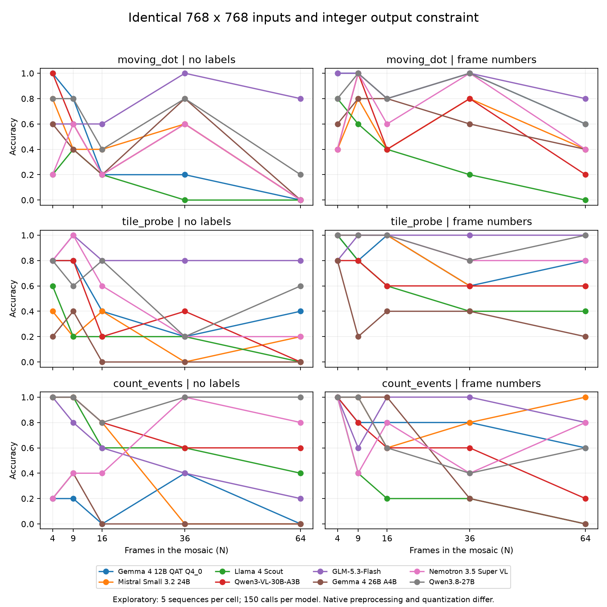

# Matched 768 x 768 input comparison

1200 scored calls: 150 per model, three tasks, five grid sizes (4, 9, 16, 36, 64),
labels off/on, and five sequences per cell (indices 0-4, base seed 0).
The same 150 PNG hashes, task/system prompts, ground truths, integer JSON schema,
temperature 0 and 32-token output cap were verified across all models.

Every response returned the requested model identity. Scores and format failures
were independently checked; unfinished or non-integer outputs count as wrong.

| Model | Overall | Labels off | Labels on |
| --- | ---: | ---: | ---: |
| Gemma 4 12B QAT Q4_0 | 91/150 (60.7%) | 28/75 (37.3%) | 63/75 (84.0%) |
| Mistral Small 3.2 24B | 88/150 (58.7%) | 31/75 (41.3%) | 57/75 (76.0%) |
| Llama 4 Scout | 63/150 (42.0%) | 28/75 (37.3%) | 35/75 (46.7%) |
| Qwen3-VL-30B-A3B | 90/150 (60.0%) | 43/75 (57.3%) | 47/75 (62.7%) |
| GLM-5.3-Flash | 123/150 (82.0%) | 54/75 (72.0%) | 69/75 (92.0%) |
| Gemma 4 26B A4B | 58/150 (38.7%) | 16/75 (21.3%) | 42/75 (56.0%) |
| Nemotron 3.5 Super VL | 93/150 (62.0%) | 36/75 (48.0%) | 57/75 (76.0%) |
| Qwen3.8-27B | 117/150 (78.0%) | 54/75 (72.0%) | 63/75 (84.0%) |

## Output failures

Counts below overlap: a cutoff is also an invalid final answer.

| Model | Cutoffs | Invalid final answers | Responses with reasoning text |
| --- | ---: | ---: | ---: |
| Gemma 4 12B QAT Q4_0 | 0 | 0 | 0 |
| Mistral Small 3.2 24B | 0 | 0 | 0 |
| Llama 4 Scout | 0 | 0 | 0 |
| Qwen3-VL-30B-A3B | 0 | 0 | 0 |
| GLM-5.3-Flash | 21 | 21 | 88 |
| Gemma 4 26B A4B | 52 | 52 | 0 |
| Nemotron 3.5 Super VL | 0 | 0 | 0 |
| Qwen3.8-27B | 0 | 0 | 0 |

## Task results

| Task | Labels | Gemma 4 12B QAT Q4_0 | Mistral Small 3.2 24B | Llama 4 Scout | Qwen3-VL-30B-A3B | GLM-5.3-Flash | Gemma 4 26B A4B | Nemotron 3.5 Super VL | Qwen3.8-27B |
| --- | --- | ---: | ---: | ---: | ---: | ---: | ---: | ---: | ---: |
| moving_dot | off | 11/25 (44.0%) | 11/25 (44.0%) | 4/25 (16.0%) | 12/25 (48.0%) | 18/25 (72.0%) | 10/25 (40.0%) | 8/25 (32.0%) | 15/25 (60.0%) |
| moving_dot | on | 22/25 (88.0%) | 14/25 (56.0%) | 10/25 (40.0%) | 14/25 (56.0%) | 23/25 (92.0%) | 16/25 (64.0%) | 17/25 (68.0%) | 21/25 (84.0%) |
| tile_probe | off | 13/25 (52.0%) | 6/25 (24.0%) | 6/25 (24.0%) | 11/25 (44.0%) | 21/25 (84.0%) | 3/25 (12.0%) | 14/25 (56.0%) | 15/25 (60.0%) |
| tile_probe | on | 21/25 (84.0%) | 21/25 (84.0%) | 16/25 (64.0%) | 17/25 (68.0%) | 24/25 (96.0%) | 10/25 (40.0%) | 23/25 (92.0%) | 24/25 (96.0%) |
| count_events | off | 4/25 (16.0%) | 14/25 (56.0%) | 18/25 (72.0%) | 20/25 (80.0%) | 15/25 (60.0%) | 3/25 (12.0%) | 14/25 (56.0%) | 24/25 (96.0%) |
| count_events | on | 20/25 (80.0%) | 22/25 (88.0%) | 9/25 (36.0%) | 16/25 (64.0%) | 22/25 (88.0%) | 16/25 (64.0%) | 17/25 (68.0%) | 18/25 (72.0%) |

## All cells

Each cell contains only five sequences; percentages move in 20-point steps.

| Task | N | Labels | Gemma 4 12B QAT Q4_0 | Mistral Small 3.2 24B | Llama 4 Scout | Qwen3-VL-30B-A3B | GLM-5.3-Flash | Gemma 4 26B A4B | Nemotron 3.5 Super VL | Qwen3.8-27B |
| --- | ---: | --- | ---: | ---: | ---: | ---: | ---: | ---: | ---: | ---: |
| moving_dot | 4 | off | 5/5 (100.0%) | 4/5 (80.0%) | 1/5 (20.0%) | 5/5 (100.0%) | 3/5 (60.0%) | 3/5 (60.0%) | 1/5 (20.0%) | 4/5 (80.0%) |
| moving_dot | 4 | on | 5/5 (100.0%) | 2/5 (40.0%) | 4/5 (80.0%) | 2/5 (40.0%) | 5/5 (100.0%) | 3/5 (60.0%) | 2/5 (40.0%) | 4/5 (80.0%) |
| moving_dot | 9 | off | 4/5 (80.0%) | 2/5 (40.0%) | 2/5 (40.0%) | 3/5 (60.0%) | 3/5 (60.0%) | 2/5 (40.0%) | 3/5 (60.0%) | 4/5 (80.0%) |
| moving_dot | 9 | on | 5/5 (100.0%) | 4/5 (80.0%) | 3/5 (60.0%) | 5/5 (100.0%) | 5/5 (100.0%) | 4/5 (80.0%) | 5/5 (100.0%) | 5/5 (100.0%) |
| moving_dot | 16 | off | 1/5 (20.0%) | 2/5 (40.0%) | 1/5 (20.0%) | 1/5 (20.0%) | 3/5 (60.0%) | 1/5 (20.0%) | 1/5 (20.0%) | 2/5 (40.0%) |
| moving_dot | 16 | on | 4/5 (80.0%) | 2/5 (40.0%) | 2/5 (40.0%) | 2/5 (40.0%) | 4/5 (80.0%) | 4/5 (80.0%) | 3/5 (60.0%) | 4/5 (80.0%) |
| moving_dot | 36 | off | 1/5 (20.0%) | 3/5 (60.0%) | 0/5 (0.0%) | 3/5 (60.0%) | 5/5 (100.0%) | 4/5 (80.0%) | 3/5 (60.0%) | 4/5 (80.0%) |
| moving_dot | 36 | on | 5/5 (100.0%) | 4/5 (80.0%) | 1/5 (20.0%) | 4/5 (80.0%) | 5/5 (100.0%) | 3/5 (60.0%) | 5/5 (100.0%) | 5/5 (100.0%) |
| moving_dot | 64 | off | 0/5 (0.0%) | 0/5 (0.0%) | 0/5 (0.0%) | 0/5 (0.0%) | 4/5 (80.0%) | 0/5 (0.0%) | 0/5 (0.0%) | 1/5 (20.0%) |
| moving_dot | 64 | on | 3/5 (60.0%) | 2/5 (40.0%) | 0/5 (0.0%) | 1/5 (20.0%) | 4/5 (80.0%) | 2/5 (40.0%) | 2/5 (40.0%) | 3/5 (60.0%) |
| tile_probe | 4 | off | 4/5 (80.0%) | 2/5 (40.0%) | 3/5 (60.0%) | 4/5 (80.0%) | 4/5 (80.0%) | 1/5 (20.0%) | 4/5 (80.0%) | 4/5 (80.0%) |
| tile_probe | 4 | on | 5/5 (100.0%) | 5/5 (100.0%) | 5/5 (100.0%) | 4/5 (80.0%) | 4/5 (80.0%) | 4/5 (80.0%) | 5/5 (100.0%) | 5/5 (100.0%) |
| tile_probe | 9 | off | 4/5 (80.0%) | 1/5 (20.0%) | 1/5 (20.0%) | 4/5 (80.0%) | 5/5 (100.0%) | 2/5 (40.0%) | 5/5 (100.0%) | 3/5 (60.0%) |
| tile_probe | 9 | on | 4/5 (80.0%) | 5/5 (100.0%) | 4/5 (80.0%) | 4/5 (80.0%) | 5/5 (100.0%) | 1/5 (20.0%) | 5/5 (100.0%) | 5/5 (100.0%) |
| tile_probe | 16 | off | 2/5 (40.0%) | 2/5 (40.0%) | 1/5 (20.0%) | 1/5 (20.0%) | 4/5 (80.0%) | 0/5 (0.0%) | 3/5 (60.0%) | 4/5 (80.0%) |
| tile_probe | 16 | on | 5/5 (100.0%) | 5/5 (100.0%) | 3/5 (60.0%) | 3/5 (60.0%) | 5/5 (100.0%) | 2/5 (40.0%) | 5/5 (100.0%) | 5/5 (100.0%) |
| tile_probe | 36 | off | 1/5 (20.0%) | 0/5 (0.0%) | 1/5 (20.0%) | 2/5 (40.0%) | 4/5 (80.0%) | 0/5 (0.0%) | 1/5 (20.0%) | 1/5 (20.0%) |
| tile_probe | 36 | on | 3/5 (60.0%) | 3/5 (60.0%) | 2/5 (40.0%) | 3/5 (60.0%) | 5/5 (100.0%) | 2/5 (40.0%) | 4/5 (80.0%) | 4/5 (80.0%) |
| tile_probe | 64 | off | 2/5 (40.0%) | 1/5 (20.0%) | 0/5 (0.0%) | 0/5 (0.0%) | 4/5 (80.0%) | 0/5 (0.0%) | 1/5 (20.0%) | 3/5 (60.0%) |
| tile_probe | 64 | on | 4/5 (80.0%) | 3/5 (60.0%) | 2/5 (40.0%) | 3/5 (60.0%) | 5/5 (100.0%) | 1/5 (20.0%) | 4/5 (80.0%) | 5/5 (100.0%) |
| count_events | 4 | off | 1/5 (20.0%) | 5/5 (100.0%) | 5/5 (100.0%) | 5/5 (100.0%) | 5/5 (100.0%) | 1/5 (20.0%) | 1/5 (20.0%) | 5/5 (100.0%) |
| count_events | 4 | on | 5/5 (100.0%) | 5/5 (100.0%) | 5/5 (100.0%) | 5/5 (100.0%) | 5/5 (100.0%) | 5/5 (100.0%) | 5/5 (100.0%) | 5/5 (100.0%) |
| count_events | 9 | off | 1/5 (20.0%) | 5/5 (100.0%) | 5/5 (100.0%) | 5/5 (100.0%) | 4/5 (80.0%) | 2/5 (40.0%) | 2/5 (40.0%) | 5/5 (100.0%) |
| count_events | 9 | on | 4/5 (80.0%) | 5/5 (100.0%) | 2/5 (40.0%) | 4/5 (80.0%) | 3/5 (60.0%) | 5/5 (100.0%) | 2/5 (40.0%) | 5/5 (100.0%) |
| count_events | 16 | off | 0/5 (0.0%) | 4/5 (80.0%) | 3/5 (60.0%) | 4/5 (80.0%) | 3/5 (60.0%) | 0/5 (0.0%) | 2/5 (40.0%) | 4/5 (80.0%) |
| count_events | 16 | on | 4/5 (80.0%) | 3/5 (60.0%) | 1/5 (20.0%) | 3/5 (60.0%) | 5/5 (100.0%) | 5/5 (100.0%) | 4/5 (80.0%) | 3/5 (60.0%) |
| count_events | 36 | off | 2/5 (40.0%) | 0/5 (0.0%) | 3/5 (60.0%) | 3/5 (60.0%) | 2/5 (40.0%) | 0/5 (0.0%) | 5/5 (100.0%) | 5/5 (100.0%) |
| count_events | 36 | on | 4/5 (80.0%) | 4/5 (80.0%) | 1/5 (20.0%) | 3/5 (60.0%) | 5/5 (100.0%) | 1/5 (20.0%) | 2/5 (40.0%) | 2/5 (40.0%) |
| count_events | 64 | off | 0/5 (0.0%) | 0/5 (0.0%) | 2/5 (40.0%) | 3/5 (60.0%) | 1/5 (20.0%) | 0/5 (0.0%) | 4/5 (80.0%) | 5/5 (100.0%) |
| count_events | 64 | on | 3/5 (60.0%) | 5/5 (100.0%) | 0/5 (0.0%) | 1/5 (20.0%) | 4/5 (80.0%) | 0/5 (0.0%) | 4/5 (80.0%) | 3/5 (60.0%) |

## Usage and timing

| Model | Mean prompt tokens | Median request seconds | Provider-estimated USD for 150 scored calls |
| --- | ---: | ---: | ---: |
| Gemma 4 12B QAT Q4_0 | 373.03 | 0.599 | local; electricity not measured |
| Mistral Small 3.2 24B | 913.87 | 0.720 | 0.01035260 |
| Llama 4 Scout | 1561.33 | 0.652 | 0.02351000 |
| Qwen3-VL-30B-A3B | 686.53 | 0.800 | 0.01565640 |
| GLM-5.3-Flash | 893.33 | 0.935 | 0.01392984 |
| Gemma 4 26B A4B | 374.03 | 0.794 | 0.00457097 |
| Nemotron 3.5 Super VL | 691.87 | 0.573 | 0.01574150 |
| Qwen3.8-27B | 691.53 | 0.785 | 0.01621013 |

These are prompt-token totals including task text and image overhead, not isolated
vision-token counts. Timings were collected while runs overlapped and are descriptive.

## Scope and limitations

This is a matched-input-resolution comparison of deployed configurations, not a
token-matched comparison or an isolated model effect. Hosted preprocessing remains
unobserved. Local Gemma used llama.cpp b9555, QAT Q4_0 weights, BF16 projector,
an 8192-token context, image_max_tokens=256, Vulkan, and thinking disabled.
Model/projector/binary hashes and exact hosted IDs are retained in the run protocols.

All mosaics were built with the original generator, align=48 and the default 1536
source-side budget, then resized to exactly 768 x 768 with Pillow LANCZOS. These
are new measurements; the original report's tables have not been changed.

The requested output schema specifies an integer but does not restrict it to the
correct answer range. Out-of-range integers are scored as wrong, never removed.

Smoke sequence 99, the earlier unconstrained Mistral sweep, and failed Scout format
checks are excluded. They remain in their own files. Scout's prose/truncation in
those checks prompted the same integer-schema constraint for all models.

Five sequences per cell support an exploratory comparison, not a precise ranking
or a new estimate of the 90% breaking point. No confidence or significance claim is made.

Qwen3-VL-30B-A3B-Instruct was added on DeepInfra using the saved sweep runner,
without new smoke tests. It is distinct from the local Qwen 3.5 4B model.
The 30B-A3B option was selected over Qwen3-VL-235B-A22B-Instruct because the
catalog prices were USD 0.15/0.60 versus 0.20/0.88 per million input/output
tokens. Both have Apache 2.0 model licenses and use hosted hardware; measured
request latency is reported above. The Qwen run retains its live catalog entry.

The four expansion models were requested with reasoning_effort=none; the earlier
hosted runs omitted that option. Exact options and catalog entries are archived.
GLM Flash nevertheless returned reasoning text on some calls; Gemma 26B returned
long digit strings on some calls. Their fixed-32-token scores include these failures
and cannot be interpreted as isolated vision accuracy. No requests were retried.

DeepInfra documents reasoning_effort=none as disabling reasoning:
[reasoning controls](https://docs.deepinfra.com/chat/reasoning). The saved response
fields, rather than that documented expectation, determine the failure counts above.

The exact GLM-5.3 and DeepSeek-V4-Flash IDs were omitted because DeepInfra's
catalog listed text-only inputs. No different model ID was silently substituted.

Sources: [30B provider](https://deepinfra.com/Qwen/Qwen3-VL-30B-A3B-Instruct),
[235B provider](https://deepinfra.com/Qwen/Qwen3-VL-235B-A22B-Instruct),
[30B license](https://huggingface.co/Qwen/Qwen3-VL-30B-A3B-Instruct),
[235B license](https://huggingface.co/Qwen/Qwen3-VL-235B-A22B-Instruct).

## Reproduce this summary

```powershell
python -B -m runner.matched_768 --summarize
```

This command reads saved JSONL files and makes no model calls. It fails if any run
is incomplete, duplicated, has mismatched input hashes/prompts, or inconsistent scores.

Inputs:

- `results/gemma_matched768_schema_v1/gemma_sweep.jsonl`
- `results/deepinfra_matched768_schema_v1/mistral_sweep.jsonl`
- `results/deepinfra_matched768_schema_v1/scout_sweep.jsonl`
- `results/deepinfra_qwen30_matched768_schema_v1/qwen30_sweep.jsonl`
- `results/deepinfra_expansion_matched768_schema_v1/glmflash_sweep.jsonl`
- `results/deepinfra_expansion_matched768_schema_v1/gemma26_sweep.jsonl`
- `results/deepinfra_expansion_matched768_schema_v1/nemotron_sweep.jsonl`
- `results/deepinfra_expansion_matched768_schema_v1/qwen38_sweep.jsonl`


