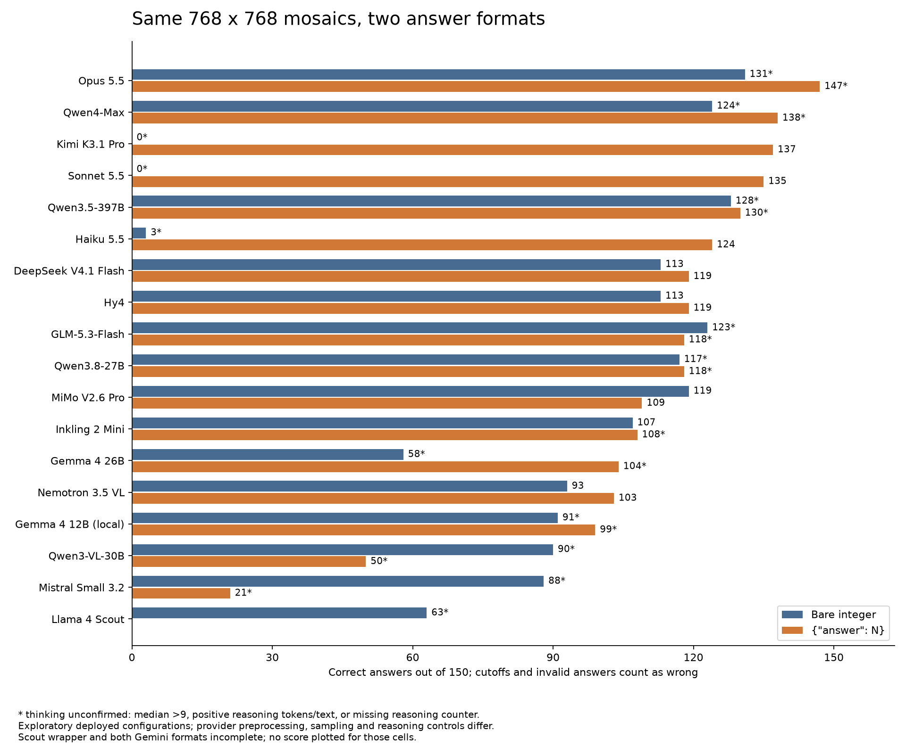
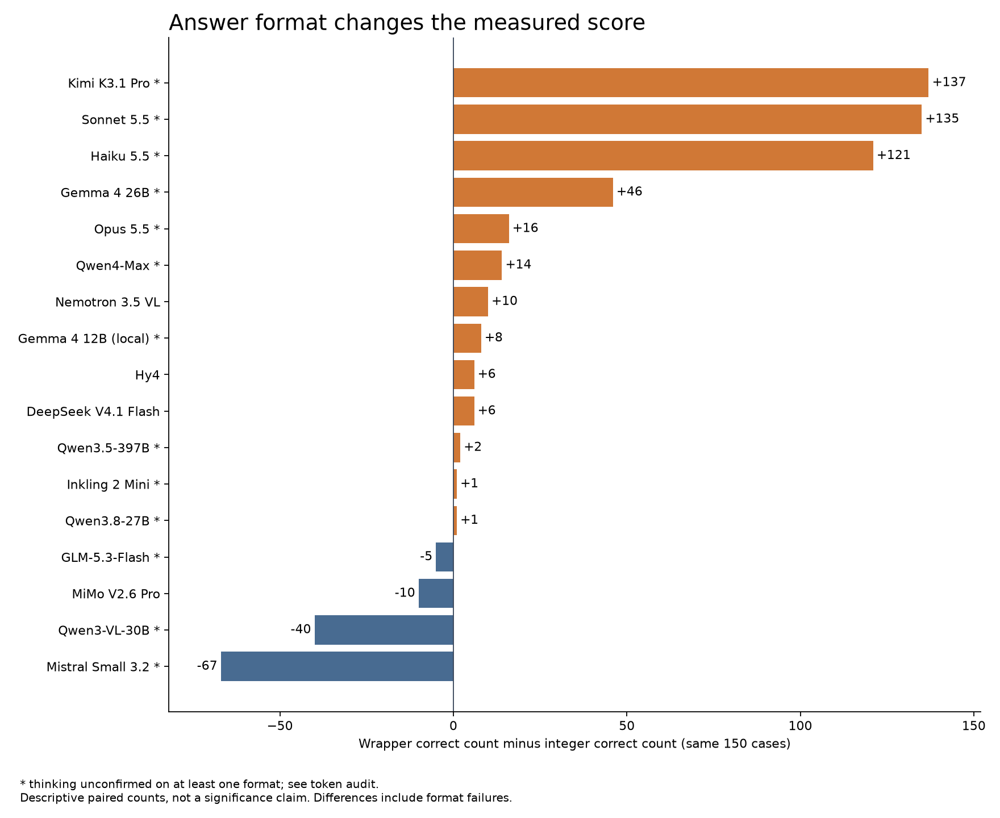
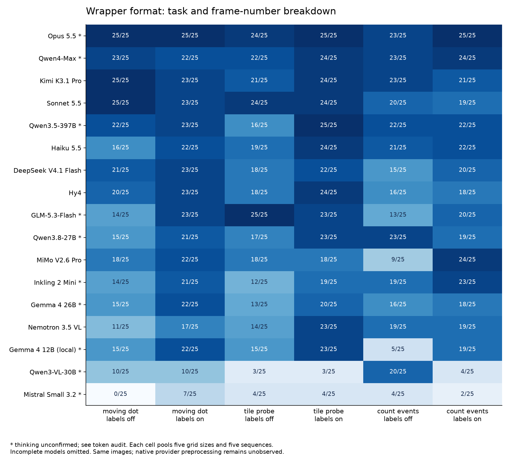

# Matched-768: answer format comparison

35 complete runs; 5,250 scored responses. Each run uses the same 150 cases:
three tasks, five grid sizes (4, 9, 16, 36, 64), labels off/on, five sequences per cell.
Images are 768 x 768; the output cap is 32 tokens. Cutoffs and invalid answers count as wrong.

This compares deployed configurations, not matched reasoning compute or isolated vision accuracy.
Claude omits temperature and uses model-specific thinking controls; Opus requests low effort.
Other selected runs use temperature 0. Requested reasoning controls do not prove reasoning was disabled.

## Reading the notes

**"thinking unconfirmed"** flags any run with median completion tokens >9, any positive reported reasoning
tokens/text, or an unavailable reasoning counter. The >9 threshold is a conservative screening rule,
not proof of hidden reasoning: a wrapper or a repeated digit string can also use more tokens.
A zero is shown only when the provider explicitly reports it; missing counters stay missing.
Otherwise the note is "provider reports zero reasoning tokens", not a claim about unobserved computation.

Qwen4-Max has no reasoning-token counter on either format. Kimi explicitly reports zero on all 300
responses; its integer run nevertheless reaches 32 tokens on all 150 calls. These scores describe
the requested output protocol, not a verified all-model thinking-off comparison.

## Scores and token audit

Completion columns include final output and any reasoning counted by the provider. Claude uses
output_tokens and output_tokens_details.thinking_tokens; other APIs use completion_tokens and
completion_tokens_details.reasoning_tokens. Reasoning totals cover only reported counters.

| Model | Format | Correct /150 | Cutoffs | Completion median [min-max] | Completion total | Reasoning total | Counter present /150 | Positive reasoning calls | Note |
| --- | --- | ---: | ---: | --- | ---: | ---: | ---: | ---: | --- |
| DeepSeek V4.1 Flash | integer | 113 | 0 | 2 [2-2] | 300 | 0 | 150 | 0 | provider reports zero reasoning tokens |
| DeepSeek V4.1 Flash | object | 119 | 0 | 8 [7-13] | 1145 | 0 | 150 | 0 | provider reports zero reasoning tokens |
| GLM-5.3-Flash | integer | 123 | 21 | 9 [3-32] | 1996 | 1689 | 150 | 88 | thinking unconfirmed: positive provider-reported reasoning tokens; reasoning text returned |
| GLM-5.3-Flash | object | 118 | 26 | 15.5 [7-32] | 2724 | 1681 | 150 | 91 | thinking unconfirmed: median completion tokens > 9 (screening rule, not proof); positive provider-reported reasoning tokens; reasoning text returned |
| Gemma 4 12B (local) | integer | 91 | 0 | 7 [7-10] | 1143 | missing | 0 | 0 | thinking unconfirmed: reasoning counter missing on 150 responses |
| Gemma 4 12B (local) | object | 99 | 0 | 12 [12-15] | 1894 | missing | 0 | 0 | thinking unconfirmed: median completion tokens > 9 (screening rule, not proof); reasoning counter missing on 150 responses |
| Gemma 4 26B | integer | 58 | 52 | 3 [2-32] | 1893 | missing | 0 | 0 | thinking unconfirmed: reasoning counter missing on 150 responses |
| Gemma 4 26B | object | 104 | 0 | 8 [7-9] | 1234 | missing | 0 | 0 | thinking unconfirmed: reasoning counter missing on 150 responses |
| Haiku 5.5 | integer | 3 | 147 | 32 [2-32] | 4712 | 0 | 150 | 0 | thinking unconfirmed: median completion tokens > 9 (screening rule, not proof) |
| Haiku 5.5 | object | 124 | 0 | 9 [8-12] | 1386 | 0 | 150 | 0 | provider reports zero reasoning tokens |
| Hy4 | integer | 113 | 0 | 2 [2-2] | 300 | 0 | 150 | 0 | provider reports zero reasoning tokens |
| Hy4 | object | 119 | 0 | 7 [6-13] | 1137 | 0 | 150 | 0 | provider reports zero reasoning tokens |
| Inkling 2 Mini | integer | 107 | 0 | 5 [5-5] | 750 | 0 | 150 | 0 | provider reports zero reasoning tokens |
| Inkling 2 Mini | object | 108 | 0 | 12 [11-12] | 1765 | 0 | 150 | 0 | thinking unconfirmed: median completion tokens > 9 (screening rule, not proof) |
| Kimi K3.1 Pro | integer | 0 | 150 | 32 [32-32] | 4800 | 0 | 150 | 0 | thinking unconfirmed: median completion tokens > 9 (screening rule, not proof) |
| Kimi K3.1 Pro | object | 137 | 0 | 6 [6-7] | 902 | 0 | 150 | 0 | provider reports zero reasoning tokens |
| Llama 4 Scout | integer | 63 | 0 | 2 [2-2] | 300 | missing | 0 | 0 | thinking unconfirmed: reasoning counter missing on 150 responses |
| MiMo V2.6 Pro | integer | 119 | 0 | 2 [2-3] | 353 | 0 | 150 | 0 | provider reports zero reasoning tokens |
| MiMo V2.6 Pro | object | 109 | 0 | 8 [8-9] | 1255 | 0 | 150 | 0 | provider reports zero reasoning tokens |
| Mistral Small 3.2 | integer | 88 | 0 | 2 [2-3] | 358 | missing | 0 | 0 | thinking unconfirmed: reasoning counter missing on 150 responses |
| Mistral Small 3.2 | object | 21 | 114 | 32 [8-32] | 4239 | missing | 0 | 0 | thinking unconfirmed: median completion tokens > 9 (screening rule, not proof); reasoning counter missing on 150 responses |
| Nemotron 3.5 VL | integer | 93 | 0 | 2 [2-3] | 349 | 0 | 150 | 0 | provider reports zero reasoning tokens |
| Nemotron 3.5 VL | object | 103 | 0 | 8 [8-9] | 1249 | 0 | 150 | 0 | provider reports zero reasoning tokens |
| Opus 5.5 | integer | 131 | 13 | 3 [3-32] | 827 | 416 | 150 | 13 | thinking unconfirmed: positive provider-reported reasoning tokens |
| Opus 5.5 | object | 147 | 1 | 9 [9-32] | 1373 | 32 | 150 | 1 | thinking unconfirmed: positive provider-reported reasoning tokens |
| Qwen3-VL-30B | integer | 90 | 0 | 2 [2-3] | 349 | missing | 0 | 0 | thinking unconfirmed: reasoning counter missing on 150 responses |
| Qwen3-VL-30B | object | 50 | 65 | 9 [7-32] | 2813 | missing | 0 | 0 | thinking unconfirmed: reasoning counter missing on 150 responses |
| Qwen3.5-397B | integer | 128 | 0 | 2 [2-3] | 347 | missing | 0 | 0 | thinking unconfirmed: reasoning counter missing on 150 responses |
| Qwen3.5-397B | object | 130 | 0 | 11 [11-12] | 1698 | missing | 0 | 0 | thinking unconfirmed: median completion tokens > 9 (screening rule, not proof); reasoning counter missing on 150 responses |
| Qwen3.8-27B | integer | 117 | 0 | 2 [2-3] | 347 | missing | 0 | 0 | thinking unconfirmed: reasoning counter missing on 150 responses |
| Qwen3.8-27B | object | 118 | 0 | 11 [7-12] | 1668 | missing | 0 | 0 | thinking unconfirmed: median completion tokens > 9 (screening rule, not proof); reasoning counter missing on 150 responses |
| Qwen4-Max | integer | 124 | 10 | 2 [2-32] | 649 | missing | 0 | 0 | thinking unconfirmed: reasoning counter missing on 150 responses |
| Qwen4-Max | object | 138 | 0 | 6 [6-8] | 966 | missing | 0 | 0 | thinking unconfirmed: reasoning counter missing on 150 responses |
| Sonnet 5.5 | integer | 0 | 146 | 32 [0-32] | 4680 | 0 | 149 | 0 | thinking unconfirmed: median completion tokens > 9 (screening rule, not proof); reasoning counter missing on 1 responses |
| Sonnet 5.5 | object | 135 | 0 | 9 [8-12] | 1399 | 0 | 150 | 0 | provider reports zero reasoning tokens |

## Charts







## Incomplete cells and retries

Scout wrapper and both Gemini 3.7 Flash formats have no selected complete 150-case run.
Incomplete attempts are not scored as 150-case results. Retries and earlier batches stay separate.
Selection uses the index, not the highest observed score, and no attempts are concatenated.

For the new models, the earliest verified complete run per format is selected. Qwen4-Max wrapper
and both DeepSeek V4.1 Flash / MiMo formats come from new3; their later new6 attempts failed.
The selected paths below make this explicit.

### Gemini usage from incomplete attempts

| Attempt | Responses | Completion total | Reasoning total | Positive reasoning calls | Reasoning text calls |
| --- | ---: | ---: | ---: | ---: | ---: |
| [results/deepinfra_new6_matched768_integer_v1/gemini37f_sweep.jsonl](../results/deepinfra_new6_matched768_integer_v1/gemini37f_sweep.jsonl) | 60 | 1702 | 1659 | 60 | 0 |
| [results/deepinfra_new6_matched768_object_retry1/gemini37f_sweep.jsonl](../results/deepinfra_new6_matched768_object_retry1/gemini37f_sweep.jsonl) | 2 | 56 | 53 | 2 | 0 |
| [results/deepinfra_new6_matched768_object_v1/gemini37f_sweep.jsonl](../results/deepinfra_new6_matched768_object_v1/gemini37f_sweep.jsonl) | 15 | 429 | 421 | 15 | 0 |

These are separate failed attempts, not independent additional benchmark cases.
Empty reasoning_content does not establish zero reasoning usage.

## Provenance and scope

Only table_cells.selected_path in analysis/run_index.json supplies the main scores. This generator
checks result hashes, archived runner/config hashes, 150 unique cases, model identities, image hashes,
questions, system prompts, truth, input resolution, cap, temperature and raw-answer scoring.
Historical protocol-name errors remain in the raw files; saved response_format determines the actual format.

Gemma's 91/150 integer run requires both runner_source.py and launch_source.py from its result folder.
The launcher overrides runner settings. Its hash was recorded at indexing, not in the original manifest.
The original server launch command was not saved; recorded settings and binary/model hashes remain.

Two Gemma server logs had private absolute paths redacted after the run. The index records the paths,
redaction scope and current hashes; these logs are not untouched originals. Result JSONL files were not edited.

The 4096-token thinking round, the earlier Opus 148/150 run at cap 4096, raw text-only tag tests,
smoke tests and failed attempts are excluded from the two main format tables.
Five sequences per cell support exploratory descriptions, not a precise model ranking.
Identical input pixels do not imply equal provider image tokens or equal internal preprocessing.

## Reproduce

```sh
python -B -m analysis.results_page
```

Reads existing logs only. Writes this Markdown page, docs/matched768_results.html,
analysis/matched768_tokens.json and three figures. No API keys, GPU or model calls are required.

## Selected source files

| Model | Format | Source |
| --- | --- | --- |
| DeepSeek V4.1 Flash | integer | [results/deepinfra_new3_matched768_integer_v1/dsflash41_sweep.jsonl](../results/deepinfra_new3_matched768_integer_v1/dsflash41_sweep.jsonl) |
| DeepSeek V4.1 Flash | object | [results/deepinfra_new3_matched768_object_v1/dsflash41_sweep.jsonl](../results/deepinfra_new3_matched768_object_v1/dsflash41_sweep.jsonl) |
| GLM-5.3-Flash | integer | [results/deepinfra_expansion_matched768_schema_v1/glmflash_sweep.jsonl](../results/deepinfra_expansion_matched768_schema_v1/glmflash_sweep.jsonl) |
| GLM-5.3-Flash | object | [results/deepinfra_glmflash_matched768_object_retry1/glmflash_sweep.jsonl](../results/deepinfra_glmflash_matched768_object_retry1/glmflash_sweep.jsonl) |
| Gemma 4 12B (local) | integer | [results/gemma_matched768_schema_v1/gemma_sweep.jsonl](../results/gemma_matched768_schema_v1/gemma_sweep.jsonl) |
| Gemma 4 12B (local) | object | [results/gemma_matched768_object_v1/gemma_sweep.jsonl](../results/gemma_matched768_object_v1/gemma_sweep.jsonl) |
| Gemma 4 26B | integer | [results/deepinfra_expansion_matched768_schema_v1/gemma26_sweep.jsonl](../results/deepinfra_expansion_matched768_schema_v1/gemma26_sweep.jsonl) |
| Gemma 4 26B | object | [results/deepinfra_all_matched768_object_v1/gemma26_sweep.jsonl](../results/deepinfra_all_matched768_object_v1/gemma26_sweep.jsonl) |
| Haiku 5.5 | integer | [results/claude_matched768_haiku_v1/haiku55_sweep.jsonl](../results/claude_matched768_haiku_v1/haiku55_sweep.jsonl) |
| Haiku 5.5 | object | [results/claude_matched768_haiku_object_v1/haiku55_sweep.jsonl](../results/claude_matched768_haiku_object_v1/haiku55_sweep.jsonl) |
| Hy4 | integer | [results/deepinfra_new6_matched768_integer_v1/hy4_sweep.jsonl](../results/deepinfra_new6_matched768_integer_v1/hy4_sweep.jsonl) |
| Hy4 | object | [results/deepinfra_new6_matched768_object_v1/hy4_sweep.jsonl](../results/deepinfra_new6_matched768_object_v1/hy4_sweep.jsonl) |
| Inkling 2 Mini | integer | [results/deepinfra_new6_matched768_integer_retry1/inkling2m_sweep.jsonl](../results/deepinfra_new6_matched768_integer_retry1/inkling2m_sweep.jsonl) |
| Inkling 2 Mini | object | [results/deepinfra_new6_matched768_object_retry1/inkling2m_sweep.jsonl](../results/deepinfra_new6_matched768_object_retry1/inkling2m_sweep.jsonl) |
| Kimi K3.1 Pro | integer | [results/deepinfra_kimi_matched768_integer_v1/kimi_sweep.jsonl](../results/deepinfra_kimi_matched768_integer_v1/kimi_sweep.jsonl) |
| Kimi K3.1 Pro | object | [results/deepinfra_kimi_matched768_object_v1/kimi_sweep.jsonl](../results/deepinfra_kimi_matched768_object_v1/kimi_sweep.jsonl) |
| Llama 4 Scout | integer | [results/deepinfra_matched768_schema_v1/scout_sweep.jsonl](../results/deepinfra_matched768_schema_v1/scout_sweep.jsonl) |
| MiMo V2.6 Pro | integer | [results/deepinfra_new3_matched768_integer_v1/mimo26pro_sweep.jsonl](../results/deepinfra_new3_matched768_integer_v1/mimo26pro_sweep.jsonl) |
| MiMo V2.6 Pro | object | [results/deepinfra_new3_matched768_object_v1/mimo26pro_sweep.jsonl](../results/deepinfra_new3_matched768_object_v1/mimo26pro_sweep.jsonl) |
| Mistral Small 3.2 | integer | [results/deepinfra_matched768_schema_v1/mistral_sweep.jsonl](../results/deepinfra_matched768_schema_v1/mistral_sweep.jsonl) |
| Mistral Small 3.2 | object | [results/deepinfra_mistral_matched768_object_v1/mistral_sweep.jsonl](../results/deepinfra_mistral_matched768_object_v1/mistral_sweep.jsonl) |
| Nemotron 3.5 VL | integer | [results/deepinfra_expansion_matched768_schema_v1/nemotron_sweep.jsonl](../results/deepinfra_expansion_matched768_schema_v1/nemotron_sweep.jsonl) |
| Nemotron 3.5 VL | object | [results/deepinfra_all_matched768_object_v1/nemotron_sweep.jsonl](../results/deepinfra_all_matched768_object_v1/nemotron_sweep.jsonl) |
| Opus 5.5 | integer | [results/claude_matched768_integer_v1/opus55_sweep.jsonl](../results/claude_matched768_integer_v1/opus55_sweep.jsonl) |
| Opus 5.5 | object | [results/claude_matched768_opus_object32_v1/opus55_sweep.jsonl](../results/claude_matched768_opus_object32_v1/opus55_sweep.jsonl) |
| Qwen3-VL-30B | integer | [results/deepinfra_qwen30_matched768_schema_v1/qwen30_sweep.jsonl](../results/deepinfra_qwen30_matched768_schema_v1/qwen30_sweep.jsonl) |
| Qwen3-VL-30B | object | [results/deepinfra_qwen30_matched768_object_retry1/qwen30_sweep.jsonl](../results/deepinfra_qwen30_matched768_object_retry1/qwen30_sweep.jsonl) |
| Qwen3.5-397B | integer | [results/deepinfra_qwen35_matched768_integer_v1/qwen35_sweep.jsonl](../results/deepinfra_qwen35_matched768_integer_v1/qwen35_sweep.jsonl) |
| Qwen3.5-397B | object | [results/deepinfra_qwen35_matched768_object_retry1/qwen35_sweep.jsonl](../results/deepinfra_qwen35_matched768_object_retry1/qwen35_sweep.jsonl) |
| Qwen3.8-27B | integer | [results/deepinfra_expansion_matched768_schema_v1/qwen38_sweep.jsonl](../results/deepinfra_expansion_matched768_schema_v1/qwen38_sweep.jsonl) |
| Qwen3.8-27B | object | [results/deepinfra_qwen38_matched768_object_retry1/qwen38_sweep.jsonl](../results/deepinfra_qwen38_matched768_object_retry1/qwen38_sweep.jsonl) |
| Qwen4-Max | integer | [results/deepinfra_new6_matched768_integer_v1/qwen4max_sweep.jsonl](../results/deepinfra_new6_matched768_integer_v1/qwen4max_sweep.jsonl) |
| Qwen4-Max | object | [results/deepinfra_new3_matched768_object_v1/qwen4max_sweep.jsonl](../results/deepinfra_new3_matched768_object_v1/qwen4max_sweep.jsonl) |
| Sonnet 5.5 | integer | [results/claude_matched768_integer_v1/sonnet55_sweep.jsonl](../results/claude_matched768_integer_v1/sonnet55_sweep.jsonl) |
| Sonnet 5.5 | object | [results/claude_matched768_sonnet_object_v1/sonnet55_sweep.jsonl](../results/claude_matched768_sonnet_object_v1/sonnet55_sweep.jsonl) |
